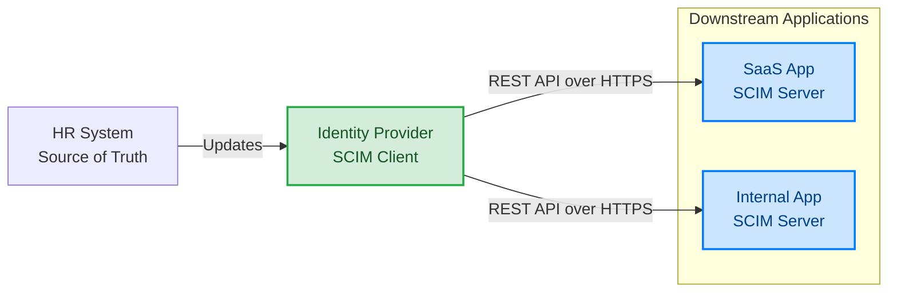
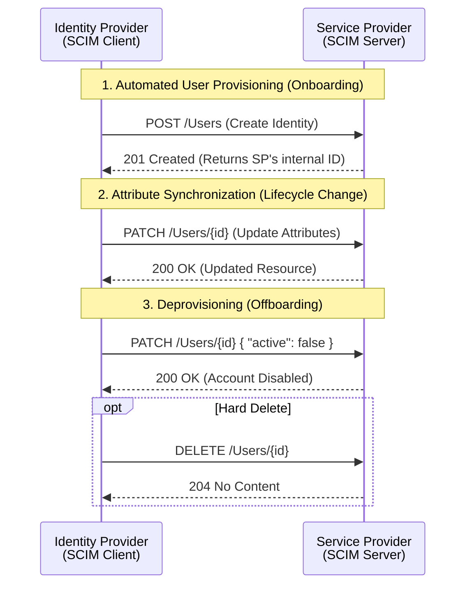

# Introduction to SCIM (System for Cross-domain Identity Management)

The System for Cross-domain Identity Management (SCIM) is an open IETF standard (RFC 7642, 7643, 7644) that automates the exchange of user identity data between identity domains or IT systems. Built on REST and JSON, SCIM provides a standardized schema and API for provisioning and managing identities across cloud applications, eliminating the need for custom API integrations for every service provider.
## Architecture Overview
At its core, SCIM operates on a client-server model where a central identity system pushes data to downstream applications.



  

## Main Concepts
* **SCIM Client (Identity Provider):** The centralized system (e.g., Microsoft Entra ID, Okta) that contains the source of truth for identities and initiates the HTTP requests to push data downstream.
* **SCIM Server (Service Provider):** The downstream application (e.g., a SaaS app or internal service) that exposes the SCIM API to receive identity data and map it to its internal database.
* **Resources:** The core entities managed by SCIM. The specification defines two primary endpoints: `/Users` and `/Groups`.
* **Schemas:** SCIM relies on a fixed, extensible JSON schema to ensure both sides understand the payload.
* **Core Schema** (`urn:ietf:params:scim:schemas:core:2.0:User`) handles standard attributes like `userName`, `name`, and `emails`.
* **Enterprise Extension** (`urn:ietf:params:scim:schemas:extension:enterprise:2.0:User`) handles organizational data like `department`, `manager`, and `employeeNumber`.

---

## The SCIM Provisioning Lifecycle
Here is how the standard provisioning lifecycle flows between an Identity Provider and a Service Provider:



## Main Scenarios

* **Automated User Provisioning:** When a new employee is added to the IdP, the SCIM client automatically sends a `POST` request to the target applications they are authorized to access, pre-creating their accounts before they even log in.
* **Attribute Synchronization:** If a user's title changes or they move to a new department, the IdP sends a `PATCH` request to update only the specific attributes in the downstream apps, keeping data consistent across the enterprise.
* **Rapid Deprovisioning (Offboarding):** When an employee leaves, disabling their account in the IdP triggers a `PATCH` (setting `"active": false`) or `DELETE` request to all connected SCIM servers. This immediately cuts off access to downstream applications.
* **Group Management:** Provisioning entire groups (`POST /Groups`) and managing their membership (`PATCH /Groups/{id}`) so that Role-Based Access Control (RBAC) relies on IdP-driven group memberships rather than local app configurations.

---

## Main APIs

SCIM maps standard CRUD operations directly to RESTful HTTP methods.

| Endpoint      | HTTP Method | Operation    | Description                                                                                                      |
| ------------- | ----------- | ------------ | ---------------------------------------------------------------------------------------------------------------- |
| `/Users`      | `GET`       | Read (Query) | Retrieves users. Supports filtering (e.g., `?filter=userName eq "vhernandez"`) and pagination.                   |
| `/Users`      | `POST`      | Create       | Provisions a new identity. The server responds with `201 Created` and the generated internal ID.                 |
| `/Users/{id}` | `GET`       | Read         | Fetches a specific identity by its SCIM ID.                                                                      |
| `/Users/{id}` | `PUT`       | Update       | Replaces the entire user resource representation. Overwrites all attributes.                                     |
| `/Users/{id}` | `PATCH`     | Update       | Applies partial modifications (add, remove, replace). Ideal for updating a single attribute or group membership. |
| `/Users/{id}` | `DELETE`    | Delete       | Instructs the server to delete (or soft-delete/disable) the identity.                                            |
  

---

## Examples
### 1. Creating a User (`POST /Users`)

The IdP sends a JSON payload utilizing both the Core and Enterprise schemas to provision a new software engineering role.

```json

{

"schemas": [

"urn:ietf:params:scim:schemas:core:2.0:User",

"urn:ietf:params:scim:schemas:extension:enterprise:2.0:User"

],

"userName": "vhernandez@axoedge.com",

"name": {

"familyName": "Hernández Guzmán",

"givenName": "Víctor"

},

"displayName": "Víctor Hernández",

"emails": [

{

"value": "vhernandez@axoedge.com",

"type": "work",

"primary": true

}

],

"active": true,

"urn:ietf:params:scim:schemas:extension:enterprise:2.0:User": {

"title": "Principal Software Engineer",

"department": "Engineering"

}

}

```

### 2. Disabling a User (`PATCH /Users/{id}`)

Rather than deleting the record (which breaks audit logs), enterprise deprovisioning typically uses `PATCH` to flip the `active` status.

```json

{

"schemas": ["urn:ietf:params:scim:api:messages:2.0:PatchOp"],

"Operations": [

{

"op": "replace",

"path": "active",

"value": false

}

]

}

```

### 3. Querying for a User (`GET /Users?filter=...`)

Before attempting to create a user, an IdP might query the SP to see if the user already exists using the SCIM filter syntax.

  
**Request:**
`GET /Users?filter=userName eq "vhernandez@axoedge.com"`

**Response:**
```json

{

"schemas": ["urn:ietf:params:scim:api:messages:2.0:ListResponse"],

"totalResults": 1,

"itemsPerPage": 1,

"startIndex": 1,

"Resources": [

{

"id": "2819c223-7f76-453a-919d-413861904646",

"userName": "vhernandez@axoedge.com",

"active": true

}

]

}

```